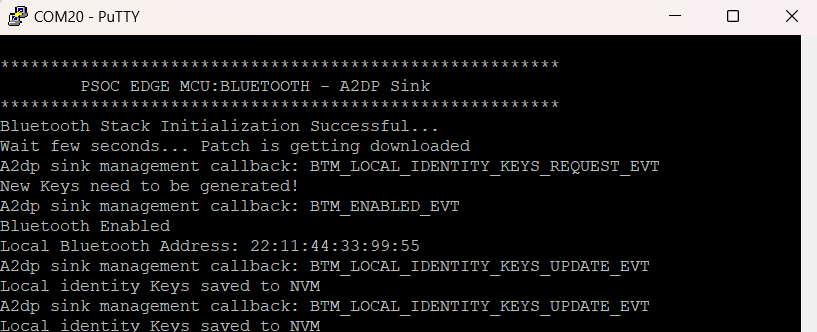
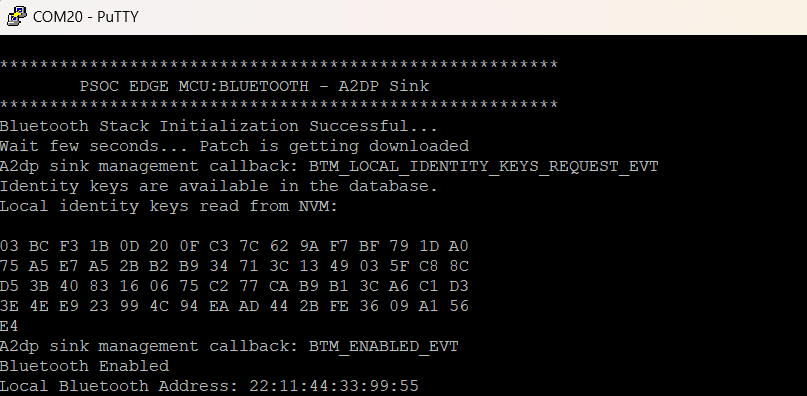

# PSOC&trade; Edge MCU: Bluetooth&reg; A2DP Sink with AVRCP

This application showcases an A2DP Sink utilizing the AIROC&trade; Wi-Fi & Bluetooth&reg; combo chip, connected to the PSOC&trade; Edge MCU via the PSOC&trade; Edge E84 evaluation kit. The application will appear as an audio sink device (IFX_A2DP_Sink), discoverable, and connectable. Once a remote device establishes a connection to the media channel, audio streamed from any music application on the A2DP Source will be rendered on the A2DP sink side and played through the onboard speaker of the PSOC&trade; Edge E84 evaluation kit.
The code example acts as an A2DP Sink (rendering device for the audio being streamed from the A2DP source). The remote device will be the A2DP source that contains the media data such as a mobile phone and the application supports the Bluetooth&reg; standard SBC decoder.

This code example has a three-project structure: CM33S secure, CM33 non-secure, and CM55 projects. The CM33 secure project is programmed and executed from RRAM. The CM33 non-secure and CM55 projects are programmed to the external QSPI flash and executed from SRAM. Extended Boot launches the CM33 secure project from a fixed location in the RRAM, which then configures the protection settings and launches the CM33 non-secure application. Additionally, the CM33 non-secure application enables CM55 CPU and launches the CM55 application.

This code examples requires you to use the **PSOC&trade; EdgeProtect Bootloader** code example as the first application to get started. By default, Edge Protect Bootloader is stored and booted from RRAM. Extended Boot launches the Edge Protect Bootloader on RRAM from a predefined address. Edge Protect Bootloader launches the next user application (PSOC&trade; Edge MCU: Bluetooth&reg; A2DP Sink). In this code example, the Edge Protect Bootloader needs to be configured to load the user application to SRAM and Launch it from SRAM.

The Edge Protect Bootloader is stored in RRAM. User application (proj_cm33_s, proj_cm33_ns and proj_cm55) is stored in the external flash. Edge Protect Bootloader loads proj_cm33_s, proj_cm33_ns and proj_cm55 from the external flash to a known location in SRAM and launches the application.

[View this README on GitHub.](https://github.com/Infineon/mtb-example-psoc-edge-btstack-a2dp-sink)

[Provide feedback on this code example.](https://yourvoice.infineon.com/jfe/form/SV_1NTns53sK2yiljn?Q_EED=eyJVbmlxdWUgRG9jIElkIjoiQ0UyNDAwNTQiLCJTcGVjIE51bWJlciI6IjAwMi00MDA1NCIsIkRvYyBUaXRsZSI6IlBTT0MmdHJhZGU7IEVkZ2UgTUNVOiBCbHVldG9vdGgmcmVnOyBBMkRQIFNpbmsgd2l0aCBBVlJDUCIsInJpZCI6ImFydmluZGt1bWFyLnN1cmVzaGt1bWFyQGluZmluZW9uLmNvbSIsIkRvYyB2ZXJzaW9uIjoiMi4xLjAiLCJEb2MgTGFuZ3VhZ2UiOiJFbmdsaXNoIiwiRG9jIERpdmlzaW9uIjoiTUNEIiwiRG9jIEJVIjoiSUNXIiwiRG9jIEZhbWlseSI6IlBTT0MifQ==)

See the [Design and implementation](docs/design_and_implementation.md) for the functional description of this code example.


## Requirements

- [ModusToolbox&trade;](https://www.infineon.com/modustoolbox) v3.7 or later (tested with v3.9)
- Board support package (BSP) minimum required version: 1.0.0
- Programming language: C
- Associated parts: All [PSOC&trade; Edge MCU](https://www.infineon.com/products/microcontroller/32-bit-psoc-arm-cortex/32-bit-psoc-edge-arm) parts

## Supported toolchains (make variable 'TOOLCHAIN')

- GNU Arm&reg; Embedded Compiler v14.2.1 (`GCC_ARM`) – Default value of `TOOLCHAIN`
- Arm&reg; Compiler v6.22 (`ARM`)
- IAR C/C++ Compiler v9.70.4 (`IAR`)
- Arm&reg; Toolchain for Embedded v22.1 (`LLVM_ARM`)

## Supported kits (make variable 'TARGET')

- [PSOC&trade; Edge E84 Evaluation Kit](https://www.infineon.com/KIT_PSE84_EVAL) (`KIT_PSE84_EVAL_EPC2`) – Default value of `TARGET`
- [PSOC&trade; Edge E84 Evaluation Kit](https://www.infineon.com/KIT_PSE84_EVAL) (`KIT_PSE84_EVAL_EPC4`)


## Hardware setup

This example uses the board's default configuration. See the kit user guide to ensure that the board is configured correctly.

Ensure the following jumper and pin configuration on board.
- BOOT SW must be in the HIGH/ON position
- J20 and J21 must be in the tristate/not connected (NC) position

## Software setup

See the [ModusToolbox&trade; tools package installation guide](https://www.infineon.com/ModusToolboxInstallguide) for information about installing and configuring the tools package.

Install a terminal emulator if you do not have one. Instructions in this document use [Tera Term](https://teratermproject.github.io/index-en.html).

This example requires no additional software or tools.

## Operation
### Create the Edge Protect Bootloader and PSOC&trade Edge MCU: Bluetooth&reg A2DP Sink Application

See [Using the code example](docs/using_the_code_example.md) for instructions on creating a project, opening it in various supported IDEs, and performing tasks, such as building, programming, and debugging the application within the respective IDEs.

1. Copy the **proj_bootloader** from **PSOC_Edge_Protect_Bootloader** to root of the A2DP Sink application that you intend to integrate the bootloader, where other projects (CM33, CM33 secure and CM55) are placed

2. In IDE, select the **PSOC_Edge_Protect_Bootloader** Project and delete it

3. Import the bootloader project in your A2DP Sink application, select the proj_bootloader and click on **Import as Project** option. Wait for the process to complete.

4. Open the Makefile in the root of the Application and add ‘proj_bootloader’ to MTB_PROJECTS variable as shown below

```
MTB_PROJECTS=proj_cm33_s proj_cm33_ns proj_cm55 proj_bootloader
```

> **Note** : Current version of bootloader does not support LLVM_ARM compiler. If your building A2DP Sink application for LLVM.
            Open the Makefile in the‘proj_bootloader’, set TOOLCHAIN variable to GCC_ARM or ARM or IAR as shown below

```
TOOLCHAIN=GCC_ARM
```

5. Use library manger or make getlibs to update the libraries

6. Open the common.mk in the root of the application and remove **#** in front of COMBINE_SIGN_JSON or replace it with the following:

```
COMBINE_SIGN_JSON=bsps/TARGET_$(TARGET)/config/GeneratedSource/boot_with_bldr.json
```

7. Connect the board to your PC using the provided USB cable through the KitProg3 USB connector

8. Open a terminal program and select the KitProg3 COM port. Set the serial port parameters to 8N1 and 115200 baud

9. Build and program the A2DP Sink application

10. Reset and observe the console logs for the application

	**Figure 1** shows the output when,

	- The kit is programmed for the first time, where the Identity keys need to be generated newly and is not available in the NVM

		or

	- The device has been paired before and the identity keys (bonding information) were cleared by pressing user button (SW2) and the reset button (XRES) together

	**Figure 1. Log messages on KitProg3 COM port (device not paired)**

    

	**Figure 2** shows the output when the kit is programmed, where the device was paired before and the identity keys are available in the database.

	**Figure 2. Log messages on KitProg3 COM port (device paired)**

    

11. On the A2DP Source side (on mobile), do the following:

	a. Open **Bluetooth** from **Settings**, and click **Scan**

	b. Pair with “**IFX_A2DP_Sink**” <br>(A2DP Sink app on the board appears with this name when discovered). Observe that the blue LED lights up on the board when bluetooth connected

	c. Open a music streaming app and start streaming audio and observe that the green LED lights up on the board

	d. Pause and resume when required

12. When you start streaming audio, the music is played on the onboard speaker

13. When you pause/resume the music on the phone's application, the audio stops and resumes at the sink side, respectively

14. The A2DP Sink also supports AVRCP playback and volume control using onboard button actions. AVRCP pass-through commands are sent to the connected source device to control playback and volume remotely.

    | Button        |     Button Action    | Result              |
    |---------------|----------------------|---------------------|
    | USER BTN1(SW2)| very long press      | Play / Pause toggle |
    | USER BTN1(SW2)| long press           | Next Track          |
    | USER BTN2(SW4)| long press           | Previous Track      |
    | USER BTN1(SW2)| short press          | Volume Up           |
    | USER BTN2(SW4)| short press          | Volume Down         |

    > **Note:**
	1. The "long press" is defined as holding the button for more than 2 seconds
    2. The "very long press" is defined as holding the button for more than 10 seconds
	3. Phone with AVRCP v1.4 and above will only support Absolute Volume. In below versions volume changes locally on the kit and doesn't get notified to phone

15. If disconnection occurs, a message is printed on the UART terminal indicating the disconnection

16. To forget a bonded device, press user button (SW2) and the reset button (XRES) together

## Related resources

Resources  | Links
-----------|----------------------------------
Application notes  | [AN235935](https://www.infineon.com/AN235935) – Getting started with PSOC&trade; Edge E8 MCU on ModusToolbox&trade; software <br> [AN236697](https://www.infineon.com/AN236697) – Getting started with PSOC&trade; MCU and AIROC&trade; Connectivity devices
Code examples  | [Using ModusToolbox&trade;](https://github.com/Infineon/Code-Examples-for-ModusToolbox-Software) on GitHub
Device documentation | [PSOC&trade; Edge MCU datasheets](https://www.infineon.com/products/microcontroller/32-bit-psoc-arm-cortex/32-bit-psoc-edge-arm#documents) <br> [PSOC&trade; Edge MCU reference manuals](https://www.infineon.com/products/microcontroller/32-bit-psoc-arm-cortex/32-bit-psoc-edge-arm#documents)
Development kits | Select your kits from the [Evaluation board finder](https://www.infineon.com/cms/en/design-support/finder-selection-tools/product-finder/evaluation-board)
Libraries  | [mtb-dsl-pse8xxgp](https://github.com/Infineon/mtb-dsl-pse8xxgp) – Device support library for PSE8XXGP <br> [retarget-io](https://github.com/Infineon/retarget-io) – Utility library to retarget STDIO messages to a UART port <br> [btstack-integration](https://github.com/Infineon/btstack-integration) – The btstack-integration hosts platform adaptation layer (porting layer) between AIROC&trade; BTSTACK and Infineon's different hardware platforms <br> [kv-store](https://github.com/Infineon/kv-store) – This library provides a convenient way to store information as key-value pairs in non-volatile storage
Tools  | [ModusToolbox&trade;](https://www.infineon.com/modustoolbox) – ModusToolbox&trade; software is a collection of easy-to-use libraries and tools enabling rapid development with Infineon MCUs for applications ranging from wireless and cloud-connected systems, edge AI/ML, embedded sense and control, to wired USB connectivity using PSOC&trade; Industrial/IoT MCUs, AIROC&trade; Wi-Fi and Bluetooth&reg; connectivity devices, XMC&trade; Industrial MCUs, and EZ-USB&trade;/EZ-PD&trade; wired connectivity controllers. ModusToolbox&trade; incorporates a comprehensive set of BSPs, HAL, libraries, configuration tools, and provides support for industry-standard IDEs to fast-track your embedded application development
<br>

## Other resources

Infineon provides a wealth of data at [www.infineon.com](https://www.infineon.com) to help you select the right device, and quickly and effectively integrate it into your design.


## Document history

Document title: *CE240054* - *PSOC&trade; Edge MCU: Bluetooth&reg; A2DP Sink*

 Version | Description of change
 ------- | ---------------------
 1.x.0   | New code example <br> Early access release
 2.0.0   | GitHub release
 2.1.0   | Updated Makefile to improve functionality
<br>


All referenced product or service names and trademarks are the property of their respective owners.

The Bluetooth&reg; word mark and logos are registered trademarks owned by Bluetooth SIG, Inc., and any use of such marks by Infineon is under license.

PSOC&trade;, formerly known as PSOC&trade;, is a trademark of Infineon Technologies. Any references to PSOC&trade; in this document or others shall be deemed to refer to PSOC&trade;.

---------------------------------------------------------

© Cypress Semiconductor Corporation, 2023-2025. This document is the property of Cypress Semiconductor Corporation, an Infineon Technologies company, and its affiliates ("Cypress").  This document, including any software or firmware included or referenced in this document ("Software"), is owned by Cypress under the intellectual property laws and treaties of the United States and other countries worldwide.  Cypress reserves all rights under such laws and treaties and does not, except as specifically stated in this paragraph, grant any license under its patents, copyrights, trademarks, or other intellectual property rights.  If the Software is not accompanied by a license agreement and you do not otherwise have a written agreement with Cypress governing the use of the Software, then Cypress hereby grants you a personal, non-exclusive, nontransferable license (without the right to sublicense) (1) under its copyright rights in the Software (a) for Software provided in source code form, to modify and reproduce the Software solely for use with Cypress hardware products, only internally within your organization, and (b) to distribute the Software in binary code form externally to end users (either directly or indirectly through resellers and distributors), solely for use on Cypress hardware product units, and (2) under those claims of Cypress's patents that are infringed by the Software (as provided by Cypress, unmodified) to make, use, distribute, and import the Software solely for use with Cypress hardware products.  Any other use, reproduction, modification, translation, or compilation of the Software is prohibited.
<br>
TO THE EXTENT PERMITTED BY APPLICABLE LAW, CYPRESS MAKES NO WARRANTY OF ANY KIND, EXPRESS OR IMPLIED, WITH REGARD TO THIS DOCUMENT OR ANY SOFTWARE OR ACCOMPANYING HARDWARE, INCLUDING, BUT NOT LIMITED TO, THE IMPLIED WARRANTIES OF MERCHANTABILITY AND FITNESS FOR A PARTICULAR PURPOSE.  No computing device can be absolutely secure.  Therefore, despite security measures implemented in Cypress hardware or software products, Cypress shall have no liability arising out of any security breach, such as unauthorized access to or use of a Cypress product. CYPRESS DOES NOT REPRESENT, WARRANT, OR GUARANTEE THAT CYPRESS PRODUCTS, OR SYSTEMS CREATED USING CYPRESS PRODUCTS, WILL BE FREE FROM CORRUPTION, ATTACK, VIRUSES, INTERFERENCE, HACKING, DATA LOSS OR THEFT, OR OTHER SECURITY INTRUSION (collectively, "Security Breach").  Cypress disclaims any liability relating to any Security Breach, and you shall and hereby do release Cypress from any claim, damage, or other liability arising from any Security Breach.  In addition, the products described in these materials may contain design defects or errors known as errata which may cause the product to deviate from published specifications. To the extent permitted by applicable law, Cypress reserves the right to make changes to this document without further notice. Cypress does not assume any liability arising out of the application or use of any product or circuit described in this document. Any information provided in this document, including any sample design information or programming code, is provided only for reference purposes.  It is the responsibility of the user of this document to properly design, program, and test the functionality and safety of any application made of this information and any resulting product.  "High-Risk Device" means any device or system whose failure could cause personal injury, death, or property damage.  Examples of High-Risk Devices are weapons, nuclear installations, surgical implants, and other medical devices.  "Critical Component" means any component of a High-Risk Device whose failure to perform can be reasonably expected to cause, directly or indirectly, the failure of the High-Risk Device, or to affect its safety or effectiveness.  Cypress is not liable, in whole or in part, and you shall and hereby do release Cypress from any claim, damage, or other liability arising from any use of a Cypress product as a Critical Component in a High-Risk Device. You shall indemnify and hold Cypress, including its affiliates, and its directors, officers, employees, agents, distributors, and assigns harmless from and against all claims, costs, damages, and expenses, arising out of any claim, including claims for product liability, personal injury or death, or property damage arising from any use of a Cypress product as a Critical Component in a High-Risk Device. Cypress products are not intended or authorized for use as a Critical Component in any High-Risk Device except to the limited extent that (i) Cypress's published data sheet for the product explicitly states Cypress has qualified the product for use in a specific High-Risk Device, or (ii) Cypress has given you advance written authorization to use the product as a Critical Component in the specific High-Risk Device and you have signed a separate indemnification agreement.
<br>
Cypress, the Cypress logo, and combinations thereof, ModusToolbox, PSoC, CAPSENSE, EZ-USB, F-RAM, and TRAVEO are trademarks or registered trademarks of Cypress or a subsidiary of Cypress in the United States or in other countries. For a more complete list of Cypress trademarks, visit www.infineon.com. Other names and brands may be claimed as property of their respective owners.